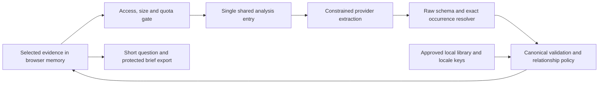

# OfferAnchor: Architecture

**Current source notice — 19 October 2026:** This revision selects `extract-v2.29 / context-audit-1.8.0`, with unchanged source-role/event guards. [Current repair and rollout status](loan-funding-release-2026-10-19.md) records four private-gateway and two actual team Alibaba checks. Earlier dated failures remain historical evidence. Frontend format, public contract 2.0.0, team Alibaba configuration and five lifetime attempts per account remain unchanged. Source publication alone does not replace the website.

**Repository/hosted separation - 18 October:** This repository revision selects `extract-v2.28 / context-audit-1.7.0`. The existing hosted trial remains v24 and is not redeployed by this update. See [submission framework](submission-framework-2026-10-18.md) for current source verification. Product scope, public contract 2.0.0, five lifetime account attempts, frontend and service configuration are unchanged. Older dated runtime paragraphs below describe their recorded checkpoint.

**Current team guide — 18 October:** Read [current product and shared facts](current-product.md) and [released trial evidence](trial-release-2026-10-18.md) first. The live trial uses official team Beijing qwen3.8-max, extract-v2.24 / context-audit-1.4.0, contract 2.0.0 and five lifetime AI action attempts per account. Knowledge/image/optional search and real Google/eight-digit email login are implemented; cloud query history is not. Earlier dated checkpoints below retain their historical meaning.

**Current release record — 18 October:** [Controlled trial, observed tests and remaining limits](trial-release-2026-10-18.md) is the current runtime/deployment authority. Active source uses extract-v2.24 / context-audit-1.4.0 with unchanged source, recipient and repayment guards; contract 2.0.0 and original fixtures/gold remain unchanged. The v24 controlled free trial is now published at offeranchor-hk.vercel.app with lifetime five-action gating; the owner accepts the original QQ sender temporarily. Portable downloads restore material for a new reading; cloud history is not implemented. The final same-six official v24 comparison has five complete results and one refusal, not an accuracy estimate. Earlier dated checkpoints below remain historical.

**Historical staged checkpoint, 18 October:** active source-bound profile `extract-v2.20 / context-audit-1.1.0` uses generation budget 1,024, audit budget 512, and at most two model calls. Timeouts are 50s model / 53s server / 58s browser, with 20s delayed-response window. Inputs above 192 source units fail closed, never truncate. The 18-case gateway evaluation is underway: three structurally complete exact projections await semantic review, with 15 cases remaining; no final result is claimed. `MODEL_CALLS_ENABLED=false` remains under a quality hold. Local Google/eight-digit email sign-in is owner-confirmed and Supabase public callback persistence is verified. Shared Supabase passed 34 checks over 61 HTTP requests for temporary auth/quota coordination metadata; it is not a job-history or evidence store. Vercel project/domain exist and encrypted production variables are saved, but code is not deployed. Opt-in history is local only; source materials are not stored in the operational database.

**Historical checkpoint, 17 October:** [Product login and release gates](authentication-2026-10-17.md) retain that dated state and observations; they are not the current profile or billing status. See the 18 October checkpoint above.

**Historical 17 October runtime note:** [image intake](image-intake-2026-10-17.md) records the guarded transcription route and unchanged analysis contract at that checkpoint. Earlier dated implementation-status statements below are historical; consult the current checkpoint above for live runtime settings.

**D23 intake/model refinement:** [the single supplement](intake-model-and-pitch.md) places optional local file conversion before the same text contract. The recorded interpretation candidate is qwen3.8-max/extract-v2.11; optional DeepSeek Flash transcription is a separate, unconnected intake stage. The independent frontend preview is the implemented presentation sample, not a second canonical analysis backend.

**Implemented subset — 16 October:** [functional integration](workspace-functional-integration-2026-10-16.md) connects the CS application to the shared analysis entry, including the guarded access/API path. Default mode remains simulation, provider null; the draft library and actual content/configuration/acceptance gates still block real model activation. Synthetic plumbing checks do not establish live or user effectiveness.

Baseline **2.2**; scope revision **11 October 2026**; original planning date **5 October 2026**. Read [PRD](PRD.md), [public contracts](contracts.md), then [frozen integration contract](integration-contract.md). This shared design now has a published controlled-trial implementation. Simulation remains the credential-free clone default. Target-state requirements, actual implementation evidence and pending live acceptance remain distinct.

## Selected design

| Area | Decision | Reason |
|---|---|---|
| Product | One Next.js/TypeScript mobile website | One connected journey for 1-2 developers |
| Evidence (original design) | Selected text in page memory; no evidence DB; optional server-side account sessions | No inbox integration or sensitive history; current shared DB is limited to temporary auth/quota coordination, with no source materials/job history |
| AI (original design, historical) | One server extraction call per attempt | Bounded cost/failure; no training/tool agent; current source-bound generation wrapper may make up to two calls under a bounded policy |
| Knowledge | Versioned local reviewed JSON + bilingual strings | Small maintained source packet, no live browsing/vector DB |
| Interpretation | Raw schema -> literal quote resolver -> canonical validator -> deterministic policy | Explicit semantic/structural boundaries |
| Output | Short independent question; expandable editable brief with protected footer | Immediate value and usable handoff |
| Follow-up | Append note/reply and reanalyse full revision | Preserve contradictory evidence |
| Reliability | CS typed reducer/API adapter with server budgets | Only bound current complete may export |

Model Studio/Qwen was the original 5 October feasibility candidate. Personal synthetic provider probes are recorded separately; they do not select an approved shared release, verify gateway routing/region/terms, or renew spending authorization. Consume the existing AI handoff and record the actual compatible model/configuration before shared live acceptance. See [AI workflow](ai-workflow.md), [sources](research-and-sources.md).

## Audience and domain boundaries: D20

The same architecture serves Hong Kong jobseekers, part-time applicants and new entrants. Student status is not a required input or gate. The first validation cohort stays students/recent graduates/early-career applicants; no age-wide effectiveness is inferred. No additional app, provider pipeline, database or device is introduced by documentation baseline 2.2.

Public contract 2.0.0 and existing module ownership remain fixed. Current guidance is financial/account-scoped: absence of a scoped demand cannot clear an identity-document request or employment terms. EXT-01 needs a separately agreed representation of collection stage/purpose/recipient/uncertainty plus compatible policy, content, UI and evaluation before activation. It is not implemented by adding a knowledge card or mapping it into an existing safe-looking result. [PRD coverage and gates](PRD.md#31-current-coverage-and-conditional-extensions) is authoritative.

## Trust and flow

Evidence, notes, provider text and old browser state are untrusted data. Configuration/library own model hosts, mode, routes and safety templates. No model tools, arbitrary URL fetch, financial action or automatic contact. Prompt boundaries assist interpretation; runtime permissions provide enforcement.

## Planned modules: one writer per path

AI/DS leads overall integration and serial task dispatch. CS implements application integration in its existing paths; other owners retain their modules. This coordination revision changes no product interface or module ownership.

The module table defines responsibilities. Current available commands and the implemented simulation subset are recorded in setup; unclosed target behavior is not inferred from directory presence. [Work packages](publication-scope.md#excluded-material) own assignments/dependencies; do not create independent scaffolds.

| Path | Owner | Contract |
|---|---|---|
| app/, components/, manifests/lockfile | CS | UI assembly, HTTP/demo gate, no provider prompt logic |
| lib/contracts/index.ts + validators | AI | Schema-derived types/request parsing/public response validation |
| lib/analysis/index.ts | AI | Single `analyze` entry used by app and evaluation |
| lib/analysis/provider.ts, extract.ts, citations.ts, policy.ts | AI | Provider, raw-to-canonical, policy; server-only |
| lib/knowledge/index.ts | AI | Load/validate/select sole root knowledge content; no copied library |
| knowledge/library.json | Communication | Editorial facts, approval, IDs, routes, global version |
| locales/en-HK.json, zh-Hant-HK.json | Design | Same stable user-facing keys; Communication reviews meaning |
| lib/session/, lib/brief/ | CS | Current-run reducer/API conversion and deterministic protected export |
| evals/student/ | DASE | Cases, independent annotations, frozen results/split |
| lib/reliability/analysis-runner.mjs | Existing reusable component | Engineering reference; not direct product API controller |

Exact callable signatures/provider/library/telemetry interfaces are specified once in the [integration handoff](integration-contract.md). CS imports the AI entry; DASE later uses the same entry/configuration. No evaluation-specific policy or CS-side second extractor.

## Server execution

1. Same-origin authorized demo access, body byte limit and abuse controls before paid work.
2. Strict request parser. Use unbound TransportError when a valid request cannot be bound; otherwise bounded analysis errors.
3. Server mode decides exact simulation registry match or live provider path. Simulation never calls a model; arbitrary edits cannot get a canned success.
4. Live: one constrained call; no paid retry. Provider signal covers connect/read; server deadline covers analysis work.
5. Validate raw shape/truncation; exact quote occurrence -> UTF-16 canonical offsets; validate references/compatibility, policy and approved library/locale coverage.
6. Return no-store complete/incomplete; only sanitized observation callback. Release transient references; provider/host retention is separately reviewed.

The reference library remains draft. Named teammate approval is a live integration gate, not a research-agent assertion. Provider probes can use synthetic cases privately before that gate; no approved-reference claim follows from a probe.

## State and browser success

Current evidence/locale owns revision; each run has a fresh request ID. Edits/reorder/note/reply/locale invalidate current result and draft; best-effort abort never guarantees remote billing stopped. A late response cannot change result, questions, error, brief or mode.

**Do not feed AnalyzeResponse directly into the existing runner's object-returning success validator.** That runner accepts any object as `completed`; an API incomplete object would then look successful. P0 uses the frozen CS reducer/API adapter in the integration contract. Existing runner tests remain engineering evidence, not proof of product handling. Optional future reuse requires a reviewed typed adapter and shared matrix tests.

Page memory only; no local/session storage, IndexedDB, evidence URLs or offline service worker. Clearing resets working state, not exported copies/processor logs or secure memory. Test phone background/resume and browser restoration; document limitations.

## Shared authentication and runtime coordination: 18 October

The remote runtime now uses [the shared-state adapter](../lib/server/shared-state.ts) and [Supabase migration](../supabase/migrations/20261018_runtime_state.sql), with deployment details in [the Vercel guide](vercel-deployment.md). The migration was applied to the existing Singapore project and the local server-only key was configured. A real isolated RPC run passed 34 checks over 61 HTTP requests at 03:01:52 UTC on 18 October: cross-instance challenges, revocation/consumption/replay, cohort/global concurrency, weighted five-call and global thirty-call limits, and service-only privileges. No email, model call or real user record was used. This is database verification; the remote application is not deployed at this checkpoint, and hosted auth/model acceptance remains separate.

Four private operational tables contain challenge emails/attempts, hashed email cooldown identifiers, usage windows and reservation leases. They contain no selected job evidence, original attachments, OTPs or session tokens. Application access uses one service-role-only RPC with an empty definer search path and a transaction lock. The normal Supabase SSR auth client keeps its publishable key; the runtime client reads only the separate server-only `SUPABASE_SERVER_KEY`. Cloud job history and sync remain unimplemented.

Loopback development can retain bounded process memory. Remote live operation and Vercel require shared configuration; selecting local mode cannot bypass that requirement. Missing/failed/uncertain store operations fail closed, without paid work or local fallback. The RPC transport uses a two-second deadline, strict bounded JSON and no retry. All production workers must share the same exact `APP_ORIGIN`, session secret and access code; origin determines the quota namespace.

Challenges expire after ten minutes; verification claims and paid concurrency leases expire after sixty seconds. Auth events become eligible for cleanup after one hour, usage-window rows after two days, and reservation replay rows one day after lease expiry. Cleanup runs on a later RPC request, so logical expiry does not guarantee immediate physical deletion. No background cleanup schedule is claimed.

Paid reservations atomically consume global and cohort allowances before outbound work. Failed attempts stay counted; release is idempotent, and a lost release is bounded by lease expiry. Active leases survive a usage-window reset. The provider adapter's declared maximum requests determines the reserved weight: one by default or two for a two-request extraction; auxiliary paid work consumes one. Public contracts and frozen fixtures are unchanged.

## Operations and delivery

Current profile `extract-v2.20 / context-audit-1.1.0` uses 1,024 generation tokens, 512 audit tokens, and at most two model calls; budgets are 50s model / 53s server / 58s browser / 20s delayed response. Inputs above 192 source units fail closed, never truncate. Shared Supabase enforcement for remote live operation is implemented and database-verified as described above; process-local limits remain a loopback development option. Hosted application acceptance is still pending. Financial cap must be authorized by account owner, not invented by docs.

Node-capable POST host is required; static export alone cannot implement this API. No provider key in client/NEXT_PUBLIC fields. [Setup](setup-and-operations.md) owns exact operational checks/defaults; actual start/build commands are added only after bootstrap.

The Oct18 release is text-only. Cut decoration and optional secondary research before evidence, correction, protected export, safe failure or strong-baseline testing. A diagram/spec cannot substitute for a working prototype. Daily connected-journey reviews expose producer/consumer drift early; [acceptance map](acceptance-matrix.md) and [shared matrix](integration-test-matrix.md) define the release evidence.

## 17 October consuming integration

The approved React presentation now lives in frontend/workspace and is compiled by Next.js at /check, retaining the existing analysis entry and core contract. Separate /api/knowledge/ask and /api/research tools use research-1.0.0 envelopes and shared server access/cost guards. Retrieved text cannot become user evidence or activate core export. See [actual implementation and limits](connected-workspace-2026-10-17.md); account authentication is described in the current extension above; no cloud evidence/history database or changed core binary-input contract is added.
